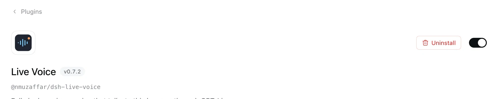

# Live Voice [](https://www.npmjs.com/package/@nmuzaffar/dsh-live-voice)

Talk to DeepSeek Harness using the GPT-Live-1 Full Duplex conversational model. 

## Install

In DSH: **Plugins → Install**, paste:

```
@nmuzaffar/dsh-live-voice
```

### Configure GPT-Live-1

Then **Plugins → Live Voice** to configure Live Voice with your OpenAI key. 



## Development

Refer to ARCHITECTURE.md for development notes and guidance. 
